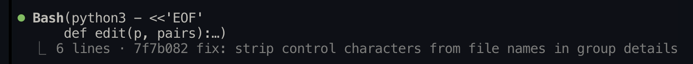
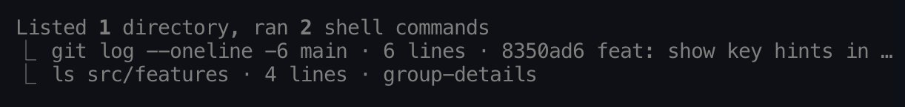
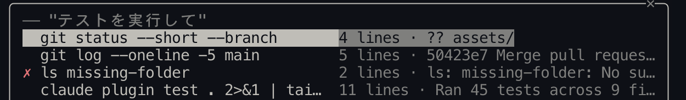
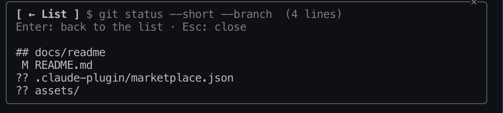

# foldview

Claude Code のトランスクリプトで、ツール実行の長い出力を1行の要約にたたむプラグインです。普段は読まない Bash の出力で画面が流れていくのを防ぎつつ、結果の要点（行数と最後の行）は見えるように残します。



## 特徴

- 長い Bash の出力を「行数 · 最後の行」の1行にたたむ。短い出力とエラーはいつもどおり全部出す
- Claude Code が1行にまとめたツールの行（「Ran 3 shell commands」「Read 3 files」など）の下に、Bash ごとの要約と、読んだファイル名・検索パターンを出す。クリックしなくても結果の要点が分かる
- `/foldview` で開くパネルから、このセッションで実行した Bash を選んで全文を読める
- 表示を変えるだけで、保存されるメッセージやモデルに渡る内容は変えない
- 要約は文字列の処理だけで作る。AI は呼ばず、ネットワークにもアクセスしない



## インストール

Claude Code のプロンプトで次を実行します。

```
/plugin install foldview --marketplace futosawaguchi/foldview
```

`Add marketplace?` と聞かれたら `y` を押し、インストール先（スコープ）を選びます。インストールしたセッションからすぐに有効になります。

シェルからインストールする場合:

```sh
claude plugin install foldview --marketplace futosawaguchi/foldview
```

## 使い方

インストールすると、長い Bash の出力が自動でたたまれます。全文を見たいときは、次のどれかを使います。

- **ctrl+o**：Claude Code 標準の全文表示。すべての行が展開されます。
- **まとめ行をクリック**：全画面モードでは、「Ran 1 shell command」などの行をクリックすると、その場で全文が開きます（Claude Code 標準の動き）。
- **`/foldview`**：Bash の一覧パネルを開きます。

### Bash の一覧パネル

`/foldview` でパネルが開き、もう一度打つと閉じます。Claude の作業中でも開けます。





| キー | 操作 |
| --- | --- |
| ↑ / ↓ / Tab | 項目を移動（クリックでも選べます） |
| Enter | 選んだ Bash の全文を出す。全文では `← List` で一覧に戻る |
| Esc | パネルを閉じる |

一覧は、このセッションの Bash を新しい順に並べ、送ったプロンプトごとに区切ります。控えるのは最新 50 件、1 件あたり 2,000 行までで、セッションを終えると消えます。

### たたむのを一時的にやめる

```
/foldview off
/foldview on
```

今のセッションだけ、たたむのをやめたり、また始めたりします。切り替えると、すでに出ている行も描き直されます。Claude Code を起動し直すと、設定項目 `enabled` の値に戻ります。

### 設定項目

`/config` を開き、「foldview」で絞り込むと変えられます。

| キー | 既定値 | 意味 |
| --- | --- | --- |
| `enabled` | `true` | たたむ機能全体のオン・オフ |
| `bashMaxLines` | `3` | Bash の出力がこの行数を超えたら、1行にたたむ |
| `groupDetails` | `true` | まとめ行の下に、Bash の要約やファイル名を出す |

## 知っておいてほしいこと

- たたんだ結果の下では、Claude Code が出す許可の行（「Allowed by auto mode」など）も見えなくなります。
- 一覧パネルには、サブエージェントが実行した Bash と、許可されずに実行されなかった Bash は入りません。
- まとめ行の下の Bash は、最後の 3 件まで出します。それより前は `+N more` とだけ出ます。
- `/foldview` はトーストで結果を知らせ、会話には何も書き込みません（書き込んだ文字はモデルにも渡るため）。

## 対応している環境

- Claude Code のターミナル版。desktop / VS Code / モバイルでは、通常の表示のままです。
- 動作を確認した版: Claude Code 2.1.325
- Claude Code のプラグイン API は early access のため、Claude Code の更新で動かなくなることがあります。

## アンインストール

```
/plugin uninstall foldview
```

## 開発

```sh
git clone https://github.com/futosawaguchi/foldview.git
cd foldview

# このフォルダのプラグインを読み込んで起動する（保存すると再読み込みされる）
claude --plugin-dir .

# 検証とテスト
claude plugin validate .
claude plugin test .
```

## ライセンス

[MIT](LICENSE)
